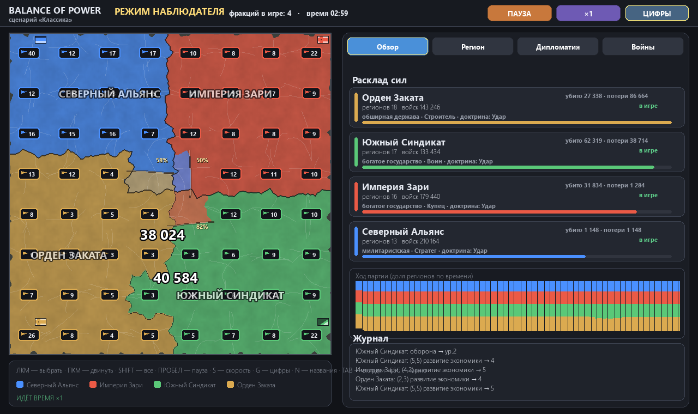

# Balance of Power

Real-time grand strategy game on pygame: maps from 6×6 to 10×10, organic
"living" borders, economy, diplomacy, doctrines and front lines.

**Authorship:** Goodfly256 + ZCode (GLM 5.3 Flash)



## Download

Grab the latest Windows installer from
[Releases](https://github.com/Goodfly256-2/balance-of-power/releases) —
no Python required. Or run from source:

```bash
pip install pygame
python menu.py
```

The game generates its music and loading screens on first launch.

## Features

- **Scenarios**: Classic, Giant Duel, Six Powers, Besieged Citadel,
  The Divide, Anarchy (8 nations on 10×10).
- **Doctrines**: Maneuver / Strike / Defense — a counter-triangle
  (Maneuver beats Strike, Strike breaks Defense, Defense grinds Maneuver).
- **Technology**: Artillery, Communications, Motorized Infantry, Medicine.
- **Ideologies**: Democracy, Monarchy, Fascism, Communism, Technocracy —
  each changes economy, army and behavior; procedural nation flags.
- **Diplomacy**: alliances with mandatory war debt (attacking an ally drags
  in its partners), pacts, trade, ally aid (Gold and Manpower), AI betrayals.
- **War**: border-region garrisons (2 tiles) with troop counts along the
  front line — **front numbers appear only for nations actually at war**,
  march interception, no-retreat rule, capture wave across regions.
- **Replays**: auto-save finished games, watch them from the main menu,
  territory-over-time chart.
- **Misc**: main menu with update check, loading screens with procedural
  landscapes, resizable window and fullscreen (F11), generated music
  (menu and in-game), observer mode.
- **Support the dev**: built-in donate tab — USDT / USDC / POL on Polygon.

## Controls

| Key | Action |
|-----|--------|
| LMB / RMB | select region / send troops |
| SHIFT + RMB | send almost all troops |
| SPACE | pause |
| S | speed ×1 → ×2 → ×4 → ×8 |
| G | show all troop numbers |
| N | nation names on the map |
| TAB | panel tabs (Overview / Region / Diplomacy / Wars) |
| F11 | fullscreen |
| ESC | back to main menu |

## Project layout

| File | Purpose |
|------|---------|
| `menu.py` | main menu (tabs, updates, replays, donate, settings) |
| `strategy.py` | match model and rendering |
| `battle_gui.py` | tactical battle (legacy) |
| `audio.py` | music generation (no dependencies) |
| `loading.py` | loading screens with procedural landscapes |
| `replays.py` | replay save/load |
| `version.py` | version, changelog, update check |
| `_fix_stress.py` | regression test (`python _fix_stress.py`) |
| `installer.iss` | Inno Setup script for the Windows installer |
| `.github/workflows/release.yml` | CI build of the installer + GitHub Release |

## Updates

The game checks `version.json` in this repository. To ship a new release,
bump `VERSION` in `version.py`, update `version.json`, tag the commit
(`git tag v1.7.0 && git push --tags`) — GitHub Actions builds the installer
and attaches it to the release automatically.

## Donate

If you like the game, you can support development with crypto on
**Polygon**: USDT, USDC or POL to

```
0xa247dd17104ee5fae4b7576cf82872a4071b03ae
```

(the same address is copyable in-game: main menu → «Поддержать» / Support).

## License

MIT — see [LICENSE](LICENSE).
